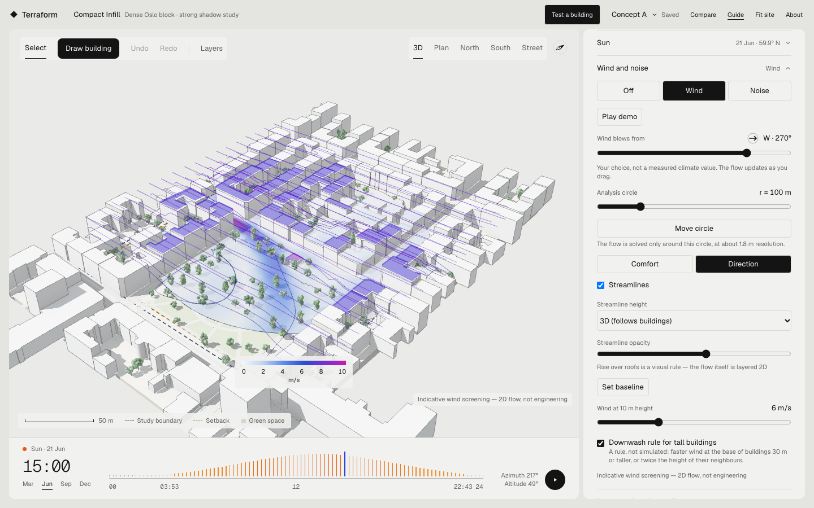
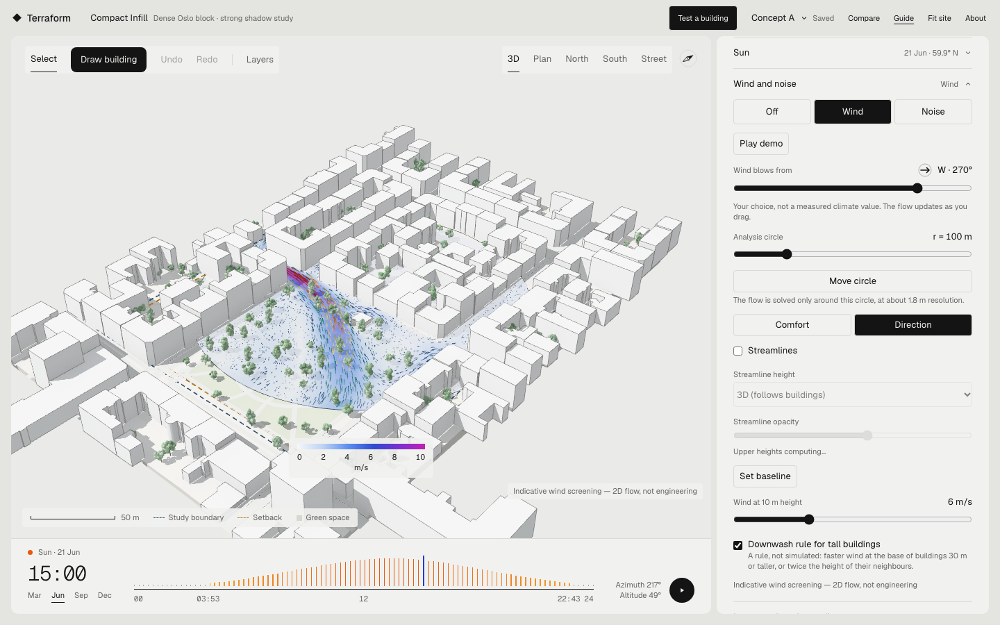
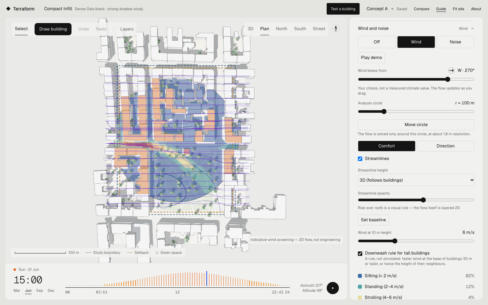
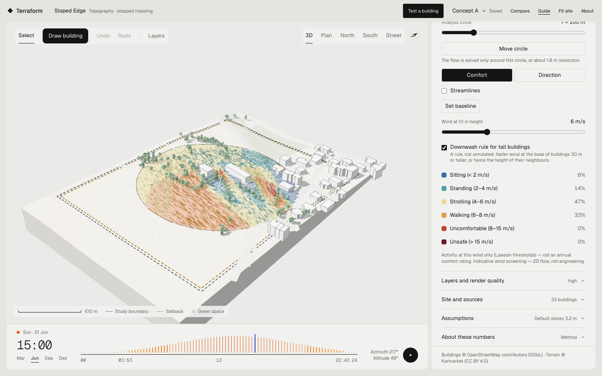
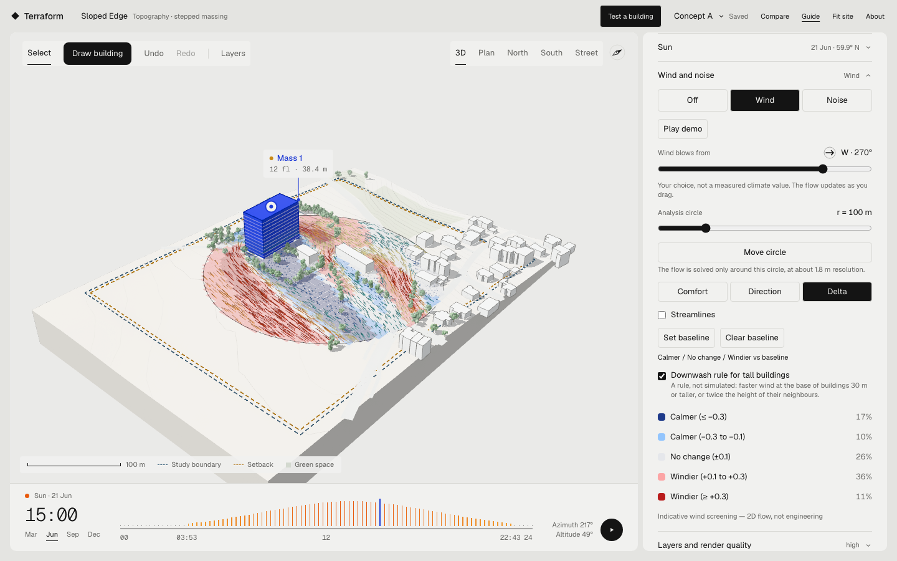

# Wind, checked early

*A case study from the Terraform studio — live 2D flow around a site, in the browser, while the
scheme is still moving.*

## 1. The problem: wind is checked late

Most building workflows check wind at the end. The massing is drawn, the area and daylight numbers
get quoted, and then — if anyone is still paying attention — a wind study is commissioned for a
scheme that is already fixed. By then the useful question is no longer "is this windy?" but "how
much of this scheme do we have to redraw?"

The cost is not only the study. It is that wind never enters the conversation as a design move. If
the wind only shows up after the building is decided, the wind can never be a building decision.

## 2. What Terraform does

The wind layer in the studio solves a live 2D flow around the site, inside an **analysis circle**
you can drag and resize (60–250 m). The circle exists because wind is a local question: the
interesting flow happens within a few hundred metres of where you are standing.

Three readings of the same field, all in the panel:

- **Comfort** — activity bands (Lawson thresholds) at the wind speed you have dialled in. Honest
  about its scope: *activity at this wind only*, not an annual comfort rating.
- **Direction** — speed against open ground. Where the ground is still the reference wind, where it
  is sheltered, where it is squeezed.
- **Delta** — set a baseline, draw a mass, and see what actually changed. "Calmer / No change /
  Windier vs baseline" over the same circle.

Streamlines draw the flow itself, and the wind dial sets direction and reference speed. The dial is
labelled as a choice, not a measurement: there is no live weather here, only the wind you pick.

The flow is *live* in the literal sense — move a mass and the field re-solves while you drag. In
one test, a 38 m tower drawn upwind on the sloped site turned 13 % of the circle "much windier"
(its shoulders) and 18 % "much calmer" (its wake) against the baseline.

**Play demo** runs a 20-second script for screen recording: the wind sweeps from west round to
east in 15° steps while the camera orbits 40°, then streamlines take over. Any click or key stops
it and restores your settings; under reduced motion it holds four directions instead.

## 3. How it works

A D2Q9 lattice-Boltzmann solver (BGK collision, plain, no turbulence model) runs on the CPU inside
a **Web Worker**, so the interface never blocks.

Two decisions carry most of the weight:

- **The site is rotated into the grid frame.** The solver always has its inlet at `x = 0` and the
  wind along `+x`; the site turns instead. One conversion pipeline, local ENU metres, no latitude
  and longitude anywhere near a mesh vertex.
- **The circle drives the resolution.** A 160 × 160 grid over 1.4 × the radius gives roughly
  1.75 m cells at r = 100 m — fine enough to read a gap between two blocks, cheap enough to
  re-solve during a drag.

Editing keeps the current field and swaps the obstacle mask (warm start); changing direction
restarts from uniform flow. About 6000 steps settles the field, after which the solver idles.

## 4. The bug that taught the most

The first working version looked fine and was quietly wrong.

The outlet was open in the textbook way — copy the neighbour's values — and in dense blocks the
density **climbed from 1.0 to 1.28** and the flow stalled. The picture still rendered: a plausible
heatmap of a flow that had quietly stopped moving. Pinning the outlet density to 1 fixed it. A
floating inlet density was tried on the way and blew up to NaN, so it was reverted.

Then the same lesson came back wearing a different hat. The *sides* of the domain were also
zero-gradient, and on a small analysis circle that let a jet pour in sideways: on one site, 38 % of
the circle read more than 1.3× the reference wind, peaking at 2.2×. The sides now hold a uniform
free stream.

The same lesson appeared a third time in the validation suite, and this is the part I keep. My
first "gap channelling" case put two blocks with a 12 m gap inside a tight domain, and the gap read
1.19× — a beautiful, publishable-looking jet. It was an artifact: a domain that tight is a wind
tunnel. With the margins the app actually uses, the gap reads 0.87× — the wind mostly goes around
the pair. The expectation was revised to match the passage-flow literature, the domain was not
re-tuned to bring the jet back, and the note says so.

**Boundary conditions are not plumbing. They are the model.** And a domain you drew for
convenience is a domain that can lie to you.

## 4b. Going "3D" without pretending to

Forma's wind view reads as 3D because the flow is evaluated above *every* surface — ground and roofs — and the streamlines rise over buildings. Terraform copies that honestly:

- The flow is solved in **height slices** (2, 10, 20, 35 m). At each height only taller buildings block the wind, so air passes over low blocks. The upper slices run on a coarser grid and start from the slice below; the whole stack is ready in about 8 s.
- **Roofs** take their colour from the slice just above them.
- **Streamlines** rise over buildings they can clear and go round taller ones. That vertical motion is a rule, and the panel says so in plain words.

The visual review of this step found the most embarrassing bug of the project: the speed slider says *wind at 10 m*, but every m/s value treated it as the speed at 2 m, so every comfort reading was about 1.4× too windy. Roofs glowed magenta; that colour, not a test, gave it away. The conversion now uses the same wind profile as the slices, and the screenshots were retaken.

## 5. Honesty

Six canonical cases and a stability check run as unit fixtures on every change; the results are
published in the [validation note](../research/wind-validation-note.md). The claims the label makes
are the only claims made:

> **Indicative wind screening — 2D flow, not engineering**

What the fixtures show, directionally: a block leaves a calm wake and a faster shoulder; a
courtyard with a closed court is nearly still; the inner corner of an L is far calmer than its
outer upwind corner; a 12 m gap is ventilated but not a jet; mass does not build up as the solver
runs. And two things they do not show:

- **A wide slab does not throw a long wake here.** In 2D, wake persistence follows a body's
  thickness along the wind, not its span — the spanwise physics is simply not in the model. The
  case is reported as *not reproduced*, not quietly re-tuned until it passed.
- **Low-rise clusters look windier beside them than they are.** In a 2D slice the wind can't go over low roofs, so on the sloped site, from six of eight directions, it speeds up round the cluster of houses (12–28 % of the circle above 1.3×). A wider domain and time-averaging didn't change it, so it's the model. The height slices show the air going over; the ground map overstates the speed-up. The sweep table is in the validation note.
- **Downwash is a rule, not a result.** A 2D slice cannot solve downwash, so the boost at the base
  of a tall building is an explicit, labelled geometric rule in `comfort.ts`, with its own tests.

The buildings are a curated Oslo demo with simplified context; the terrain and context are real
data, the constraints are illustrative and not planning advice. There is no live weather: the
reference speed is yours to choose.

## 6. What I would do next

1. **A real wind rose, baked offline.** The comfort view is honest but thin: it describes one wind
   at one speed. A per-site rose (MET Norway Frost or NORA3, fetched once and stored with the site
   package) would let the panel show an annual comfort distribution instead of a momentary one.
2. **A vertical dimension.** Even one extra dimension with a simple downwash model would replace
   the rule with a result — and let the panel drop the "this is a rule" caveat.
3. **A finer grid where it pays.** Smagorinsky LES on the largest circles only, for the corners that
   decide whether a terrace works.
4. **Wind as a comparison.** The Delta view already compares a scheme to its own baseline; comparing
   two saved scenarios side by side under the same wind would make wind a variable you optimise
   against.
